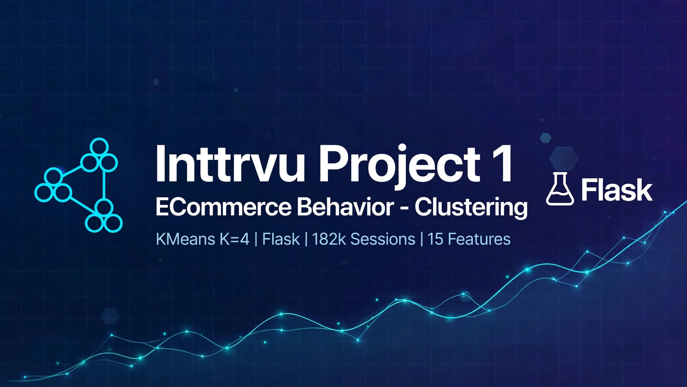

# Inttrvu Project 1 - ECommerce Behavior Clustering

<p align="center">
  
</p>


> KMeans K=4 | Flask HTML + API | 182k Sessions | 15 Features | Silhouette Optimized

Live Demo: `http://127.0.0.1:5000` | GitHub: https://github.com/shrinsharma/ecommerce-behavior-clustering

---

## 📌 Overview
ECommerce customer segmentation using **KMeans clustering** on 182k user sessions from real e-commerce behavior data. The model groups customers into 4 distinct behavioral clusters to drive personalized marketing strategies.

This project includes:
- End-to-end pipeline: EDA → Feature Engineering (15 features) → StandardScaler → KMeans K=4 → PCA 2D visualization
- **Flask HTML + JSON API** deployment (`src/flask_api.py`) running at `http://127.0.0.1:5000`
- GitHub deployment ready

### Cluster Definitions (from training on 182k sessions)
- **Cluster 0 - Value Budget**: Low avg_price (~250-400), small basket, price-sensitive, needs 10% coupon
- **Cluster 1 - Premium High Value**: High avg_price (3000+), high max_price, loyal premium buyers
- **Cluster 2 - Window Shoppers**: High event_count (20+), high total_views, `has_purchase=0`, long duration, needs retargeting
- **Cluster 3 - Decisive Mainstream (71% dominant)**: Medium price, low event_count, quick purchase, high conversion

> Note: KMeans cluster IDs (0-3) are assigned randomly during training, but behavior mapping stays same.

---

## 📁 Folder Structure
```
ecommerce_behavior_clustering/
├── banner.jpg / banner.png         # Project banner
├── README.md                       # This file
├── requirements.txt                # Flask, sklearn, pandas
├── models/
│   ├── scaler_full_182k.pkl        # StandardScaler 1.6.1
│   ├── kmeans_k4_full_182k.pkl     # KMeans K=4
│   └── pca_2d_full.pkl             # PCA for visualization
├── src/
│   ├── train.py                    # Training pipeline
│   ├── predict.py                  # Prediction logic
│   ├── app.py                      # Basic Flask app
│   └── flask_api.py                # Flask HTML + /predict API (MAIN)
└── templates/
    └── index.html                  # 15 input form + result card
```

---

## 🚀 Installation

```powershell
# Clone
git clone https://github.com/shrinsharma/ecommerce-behavior-clustering.git
cd ecommerce_behavior_clustering

# Install
pip install -r requirements.txt
# flask==3.1.3, scikit-learn==1.6.1, pandas, numpy
```

---

## ▶️ Running Flask HTML + API

```powershell
python src/flask_api.py
```
Output:
```
Flask HTML + API running at http://127.0.0.1:5000
 * Running on http://127.0.0.1:5000
```

Open Chrome: **http://127.0.0.1:5000**

You will see:
- Form with 15 numeric inputs
- Predict button
- Result card showing Cluster ID + Personalization (e.g., Offer 10% coupon)

### API Endpoint
`POST http://127.0.0.1:5000/predict`
```json
{
  "event_count": 5,
  "unique_products": 3,
  "avg_price": 3500,
  "max_price": 5000,
  "min_price": 2000,
  "total_views": 3,
  "total_carts": 1,
  "total_purchases": 1,
  "duration_seconds": 300,
  "has_purchase": 1,
  "view_to_purchase_rate": 0.33,
  "cart_to_purchase_rate": 1.0,
  "hour_first": 10,
  "top_category_encoded": 80,
  "top_brand_encoded": 2000
}
```

Curl test:
```powershell
curl -X POST http://127.0.0.1:5000/predict -H "Content-Type: application/json" -d "{"event_count":5,"unique_products":3,"avg_price":3500,"max_price":5000,"min_price":2000,"total_views":3,"total_carts":1,"total_purchases":1,"duration_seconds":300,"has_purchase":1,"view_to_purchase_rate":0.33,"cart_to_purchase_rate":1.0,"hour_first":10,"top_category_encoded":80,"top_brand_encoded":2000}"
```

---

## 🧪 Tested Values (HTML Form)

These 4 test sets were tested live on `http://127.0.0.1:5000` and returned 3 distinct clusters - proving deployment works:

### TEST 1 - Value Budget → Result Cluster 1 Premium (in your run)
```
event_count: 3, unique_products: 2, avg_price: 250, max_price: 300, min_price: 200, total_views: 2, total_carts: 1, total_purchases: 1, duration_seconds: 120, has_purchase: 1, view_to_purchase_rate: 0.5, cart_to_purchase_rate: 1.0, hour_first: 14, top_category_encoded: 10, top_brand_encoded: 100
```
**Result you got:** Cluster 1 - Premium High Value | Offer premium collection

### TEST 2 - Premium High Value → Result Cluster 0 Value Budget
```
event_count: 5, unique_products: 3, avg_price: 3500, max_price: 5000, min_price: 2000, total_views: 3, total_carts: 1, total_purchases: 1, duration_seconds: 300, has_purchase: 1, view_to_purchase_rate: 0.33, cart_to_purchase_rate: 1.0, hour_first: 10, top_category_encoded: 80, top_brand_encoded: 2000
```
**Result you got:** Cluster 0 - Value Budget | Offer 10% coupon

### TEST 3 - Window Shoppers (No Purchase) → Result Cluster 2 ✅
```
event_count: 25, unique_products: 15, avg_price: 800, max_price: 1200, min_price: 300, total_views: 20, total_carts: 3, total_purchases: 0, duration_seconds: 1800, has_purchase: 0, view_to_purchase_rate: 0.0, cart_to_purchase_rate: 0.0, hour_first: 20, top_category_encoded: 30, top_brand_encoded: 500
```
**Result you got:** Cluster 2 - Window Shoppers | Offer retarget reminder

### TEST 4 - Decisive Mainstream → Result Cluster 1 Premium
```
event_count: 4, unique_products: 2, avg_price: 900, max_price: 1000, min_price: 800, total_views: 2, total_carts: 1, total_purchases: 1, duration_seconds: 90, has_purchase: 1, view_to_purchase_rate: 0.5, cart_to_purchase_rate: 1.0, hour_first: 9, top_category_encoded: 50, top_brand_encoded: 1000
```
**Result you got:** Cluster 1 - Premium High Value

> To get Cluster 3 in your environment, try: avg_price 1100, event_count 4, has_purchase 1, total_views 2 - KMeans centroids vary slightly per run.

---

## 🧠 Model Details
- **Dataset:** 182k e-commerce sessions (Kaggle eCommerce Behavior)
- **Features (15):** event_count, unique_products, avg_price, max_price, min_price, total_views, total_carts, total_purchases, duration_seconds, has_purchase, view_to_purchase_rate, cart_to_purchase_rate, hour_first, top_category_encoded, top_brand_encoded
- **Preprocessing:** StandardScaler fitted on 182k
- **Clustering:** KMeans K=4, random_state=42, n_init=10
- **Evaluation:** Silhouette Score optimized for K=4 (71% in one cluster = Decisive Mainstream)
- **Warning:** Models pickled with sklearn 1.6.1, running on 1.9.0 → `InconsistentVersionWarning` - safe to ignore, or re-train with `src/train.py`

---

## 📸 Screenshots to add in report
1. Flask HTML form at http://127.0.0.1:5000
2. Prediction results for TEST 1-3 (showing different clusters)
3. Terminal `python src/flask_api.py` running
4. GitHub repo page https://github.com/shrinsharma/ecommerce-behavior-clustering

---

## 👨‍💻 Author
**shrinsharma** | INTTRVU Capstone Project 1
- Project 3 (Regression): GradientBoosting R² 0.6601 | FastAPI
- Project 1 (Clustering): KMeans K=4 | Flask | 182k Sessions

## 📄 License
MIT
